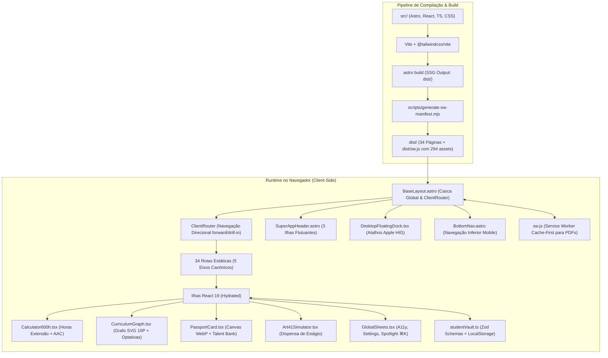

# CAGP UFMG — Super App Discente & Portal Institucional
> **Centro Acadêmico de Gestão Pública (CAGP) — FAFICH / UFMG**  
> *Engenharia de Software, Arquitetura e Guia do Desenvolvedor*

[](https://nodejs.org/)
[](https://astro.build/)
[](https://react.dev/)
[](https://tailwindcss.com/)
[](https://www.typescriptlang.org/)
[](https://vitest.dev/)
[](https://zod.dev/)
[](https://web.dev/progressive-web-apps/)

---

## 1. Visão Geral de Engenharia

O **CAGP UFMG Super App** é uma aplicação web de alto desempenho projetada para centralizar a vida acadêmica, burocrática, curricular e política dos estudantes do curso de **Graduação em Gestão Pública (Bacharelado)** da **Faculdade de Filosofia e Ciências Humanas (FAFICH)** da **Universidade Federal de Minas Gerais (UFMG)**.

Arquiteturalmente, o projeto opera sob o paradigma de **Static Site Generation (SSG)** com **Ilhas de Interatividade Seletiva (Astro Islands)**, orquestrado pela engine do **Astro 7** e alimentado por componentes reativos em **React 19**. Toda a experiência de navegação entre as 34 rotas estáticas é intermediada pelo `ClientRouter` do Astro com transições direcionais fluidas (View Transitions API), eliminando recarregamentos de página (FOUC) e conferindo sensação de aplicativo nativo de bolso.

### Pilares Arquiteturais
1. **Zero Runtime Server:** Todo o HTML é compilado para arquivos estáticos (`output: 'static'` em `dist/`), viabilizando hospedagem econômica, segura e distribuída via GitHub Pages com CDN global.
2. **Hidratação Seletiva Parcial:** O código JavaScript cliente é carregado unicamente onde estritamente necessário através de diretivas `client:load`, `client:idle` e `client:visible`.
3. **Cofre Discente Offline-First (Student Vault):** O estado da aplicação (horas de extensão/AAC, progresso no checklist, preferências de acessibilidade, notas do quiz, grade curricular personalizada e perfil com foto) é persistido localmente no navegador via `localStorage`, validado em tempo de execução por esquemas rígidos do **Zod**.
4. **Resiliência PWA & Operação Offline:** Service Worker automatizado que pré-armazena em cache mais de 290 assets (HTMLs, CSS, JS, SVGs e PDFs oficiais), permitindo que estudantes no campus Pampulha consultem ementas e calculadoras mesmo sem sinal de dados.
5. **Design System Triplo Harmonizado:** Fusão entre o rigor gráfico do **Neo-Brutalismo Brite** (bordas pretas sólidas, sombras duras angulares, tipografia monumental), os refinamentos ergonômicos do **Apple Human Interface Guidelines (HIG)** (Safe Areas, Bottom Sheets, Topbars flutuantes, Dynamic Island Toast) e a semântica do **Google Material Design 3 Expressive** (superfícies tonais e anéis de foco WCAG AAA).

---

## 2. Diagrama de Arquitetura



---

## 3. Estrutura do Repositório

```text
cagp/
├── .github/
│   └── workflows/
│       └── astro.yml                 # Workflow de CI/CD para GitHub Actions e GitHub Pages
├── _legacy_quarto/                   # Arquivo histórico dos arquivos .qmd legados da era Quarto
├── _referencias/                     # Documentação de apoio, memoriais e transcrições normativas
├── logos/                            # SVGs vetoriais originais da marca do CAGP (Os Candangos)
├── public/                           # Assets estáticos servidos diretamente na raiz
│   ├── documentos/                   # 8 PDFs oficiais do curso (PPC, Regimento, Resoluções)
│   ├── manifest.webmanifest          # Manifesto PWA com rotas, atalhos e cores
│   ├── sw.js                         # Template base do Service Worker
│   └── favicon.svg                   # Ícone vetorial do aplicativo
├── scripts/
│   ├── generate-sw-manifest.mjs      # Varre dist/ pós-build e injeta lista de precache no sw.js
│   └── seed-content.mjs              # Utilitário para geração de metadados de disciplinas
├── src/
│   ├── components/                   # Componentes organizados por domínio funcional
│   │   ├── acg/                      # Guias de tramitação de atividades complementares
│   │   ├── calculators/              # Calculadora 600h, Formulários e Guardião de 120 dias
│   │   ├── calouros/                 # Checklists de sobrevivência, FUMP e rotina noturna
│   │   ├── curriculum/               # Grafo curricular em SVG, simuladores e drawers de ementas
│   │   ├── curso/                    # Visão geral, Colegiado DCP e pesquisa de egressos
│   │   ├── documentos/               # Tutoriais DRCA e visualizadores de acervo
│   │   ├── estagio/                  # Tutoriais de TCE, regramento de estágio supervisionado
│   │   ├── gestao/                   # Organograma das 7 diretorias e prestação de contas
│   │   ├── home/                     # Bússola discente, Hero Hub e Passaporte em tempo real
│   │   ├── passport/                 # Editor de talentos, renderizador de avatar e badges
│   │   ├── percurso/                 # Quiz vocacional, linha do tempo e Minha Grade
│   │   ├── pesquisa/                 # 11 núcleos temáticos do DCP e Programa de Imersão
│   │   ├── settings/                 # Painel interativo de ajustes, cofre e backup
│   │   ├── shell/                    # Casca global: Header, BottomNav, Dock, Toast e Sheets
│   │   ├── sobre/                    # História dos Candangos, esferas e princípios republicanos
│   │   ├── tcc/                      # 4 modalidades de TCC, normas de banca e prazos
│   │   ├── ui/                       # Primitivas visuais (Banners, Chips, PageHeader, Cards)
│   │   └── widgets/                  # Widgets reativos de resumo para as páginas de visão geral
│   ├── content/
│   │   └── disciplinas/              # Coleção de dados JSON com as 27 obrigatórias e 68 optativas
│   ├── layouts/
│   │   └── BaseLayout.astro          # Casca mestre: ClientRouter, anti-FOUC, meta tags e sheets
│   ├── lib/
│   │   ├── calendar/                 # Utilitário para exportação de eventos acadêmicos (.ics)
│   │   ├── storage/
│   │   │   ├── studentVault.ts       # Esquemas Zod, defaults e API tipada do LocalStorage
│   │   │   └── backupVault.ts        # Rotinas de exportação/importação (JSON e Base64)
│   │   ├── avatarHelper.ts           # Geração de avatares SVG e presets ilustrados
│   │   ├── navigationRegistry.ts     # Registro canônico dos 5 eixos e seus 34 destinos
│   │   ├── paths.ts                  # Resolução canônica de caminhos com suporte a base path
│   │   └── shortcutsCatalog.ts       # Catálogo de atalhos discentes configuráveis
│   ├── pages/                        # Rotas estáticas compiladas pelo Astro (34 páginas)
│   └── styles/                       # CSS modular desacoplado
│       ├── animations.css            # Keyframes de impacto de carimbo, molas e shimmers
│       ├── components.css            # Estilização de cards, botões neo-brutalistas e gavetas
│       ├── drawer.css                # Menu lateral deslizante off-canvas mobile
│       ├── global.css                # Importação Tailwind v4 e variáveis de tokens
│       ├── grafo.css                 # Estilização vetorial dos nós e arestas do Grafo SVG
│       ├── navbar.css                # Topbar em ilhas flutuantes e docking
│       ├── passport.css              # Estilos do Passaporte Discente e pins de orgulho
│       ├── settings.css              # Painéis de configurações e switches táteis
│       └── stamps.css                # Carimbos brutais de deferimento/indeferimento
├── tests/                            # Suíte de testes unitários e de integração (Vitest)
│   ├── calculators.test.ts           # Testes de regras de negócio das 600h e prazos
│   ├── navigationRegistry.test.ts    # Testes de integridade das rotas e regex de match
│   ├── paths.test.ts                 # Testes de resolução de caminhos com base path
│   ├── setup.ts                      # Setup global de ambiente JSDOM
│   └── storage.test.ts               # Testes de validação Zod e isolamento de chaves do cofre
├── astro.config.mjs                  # Configuração do Astro (React, Tailwind Vite, Base path)
├── package.json                      # Scripts, dependências e motores de execução
├── tsconfig.json                     # Configuração estrita do TypeScript
└── vitest.config.ts                  # Configuração do executor de testes Vitest
```

---

## 4. O Sistema de Navegação dos 5 Eixos (`navigationRegistry.ts`)

O Super App organiza todo o conteúdo do curso em torno de **5 Eixos Temáticos Principais**, definidos de maneira centralizada em [`src/lib/navigationRegistry.ts`](file:///home/gsathler/Nextcloud/Projects/cagp/src/lib/navigationRegistry.ts). Esse arquivo atua como a única fonte de verdade para cabeçalhos, barras de navegação, breadcrumbs e a paleta Spotlight.

| Eixo | Rota Raiz | Ícone | Tagline / Propósito | Destinos Subordinados |
| :--- | :--- | :--- | :--- | :--- |
| **1. Hoje** | `/` | `bi-compass` | Rotina do Campus, RU & Bússola Discente | Bússola, Calouros, RU/Circular, Passaporte |
| **2. Curso** | `/curso` | `bi-mortarboard` | Colegiado DCP, PPC 2020 e Regulamento | Visão Geral, Guia do Calouro (`/calouros`), Pesquisa & Grupos (`/pesquisa`) |
| **3. Currículo** | `/percurso` | `bi-diagram-3` | Grade 10P, Grafo Interativo, 600h, Estágio e TCC | Grafo 10P, Optativas (`/optativas`), Horas 600h (`/acg`), Estágio (`/estagio`), TCC (`/tcc`) |
| **4. Acervo** | `/documentos` | `bi-folder2-open` | Repositório de Documentos Oficiais e FAQ | Repositório de Atos, Formulários SEI, Transcrições (`/documentos/[slug]`), FAQ (`/faq`), Mapa (`/mapa-do-site`) |
| **5. O CAGP** | `/sobre` | `bi-people` | Representação Estudantil, Estatuto e Gestão | História dos Candangos, Princípios, Diretorias & Eleições (`/gestao`) |

---

## 5. Cofre Discente & Validação com Zod (`studentVault.ts`)

A persistência do Super App é 100% descentralizada e opera diretamente no navegador do discente através do módulo [`src/lib/storage/studentVault.ts`](file:///home/gsathler/Nextcloud/Projects/cagp/src/lib/storage/studentVault.ts). Não há coleta de dados em servidores externos nem necessidade de login por senha.

### Chaves Canônicas e Esquemas Zod

| Chave no `localStorage` | Tipo Zod | Descrição e Finalidade |
| :--- | :--- | :--- |
| `cagp_student_profile_v1` | `z.object` | Perfil do discente: nome, período, pronomes, contatos, foto WebP em `dataURL`, avatar preset, biografia, interesses e bandeira de orgulho. |
| `cagp_calc_ext_aac_v1` | `z.record(z.string(), z.number())` | Registro detalhado de horas integralizadas nas 13 categorias da Calculadora 600h (Extensão + AAC). |
| `cagp_aac_120d_certs_v1` | `z.array(CertSchema)` | Certificados cadastrados no Guardião de 120 dias com datas e cálculo do prazo fatal (Art. 15, § 4º). |
| `cagp_custom_curriculum_v1`| `z.object` | Disciplinas optativas ou eletivas livres adicionadas pelo estudante ao seu Grafo Curricular. |
| `cagp_minha_grade_v1` | `z.object({ savedCourses: z.array })`| Dossiê de disciplinas salvas/selecionadas pelo aluno para planejamento de matrícula. |
| `cagp_calouro_checklist_v1`| `z.record(z.string(), z.boolean())` | Estado de conclusão das etapas de acolhimento nos primeiros 30 dias na UFMG. |
| `cagp_art41_checklist_v1` | `z.record(z.string(), z.boolean())` | Etapas concluídas para o requerimento de Dispensa de Estágio com base no Art. 41. |
| `cagp_percurso_quiz_v1` | `z.object` | Respostas do mini-quiz vocacional e percurso curricular sugerido (`01-01`, `01-02` ou `01-03`). |
| `cagp_a11y_prefs_v2` | `z.object` | Preferências de acessibilidade: escala tipográfica, alto contraste, modo dislexia, régua visual e redução de movimento. |
| `cagp_discente_shortcuts_v1`| `z.array(z.string())` | Lista ordenada dos 5 atalhos favoritos configurados pelo discente para a barra de bolso. |
| `cagp_notifications_prefs_v1`| `z.object` | Preferências de alarmes noturnos (Jantar no RU II 18h15, Último Circular 22h30, Prazos AAC). |
| `cagp_onboarding_completed_v1`| `z.boolean()` | Flag indicando se o discente já realizou o onboarding inicial do Super App. |

### Tolerância a Falhas e Sincronização Reativa
- **Fallback Automático:** Caso o discente modifique manualmente ou corrompa alguma entrada no `localStorage`, a função `getVaultItem()` captura a exceção do Zod, loga um aviso no console e retorna o valor padrão seguro (`VaultDefaults`), prevenindo *white screens*.
- **Comunicação por Eventos:** Todas as mutações no cofre disparam o evento customizado `window.dispatchEvent(new CustomEvent('cagp:vault-synced'))`, garantindo que todas as ilhas React e componentes Astro na tela atualizem seus estados imediatamente sem recarregar a página.
- **Portabilidade Zero-Servidor:** Módulo `backupVault.ts` permite exportar todo o cofre em arquivo `.json` ou em string compactada em Base64 com checksum para importação em outro dispositivo ou navegador.

---

## 6. Ilhas de Interatividade em Destaque

1. **Passaporte Discente (`PassportCard.tsx`):**
   - Incorpora um motor de recorte centralizado e compressão de foto 100% client-side via `<canvas>` HTML5 (`256x256px` em `image/webp`), garantindo imagens leves de ~15 KB salvas no `localStorage`.
   - Inclui anel de progresso circular dinâmico que reflete a integralização das 3.000 horas do curso.
2. **Calculadora de 600h (`Calculator600h.tsx`):**
   - Opera sob metáfora de dashboard financeiro com barras proporcionais de teto por modalidade (Extensão Obrigatória de 300h vs. AAC de até 300h).
   - Converte horas em créditos (`15h = 1 crédito`) e gera espelho oficial pronto para colagem no processo do SEI-UFMG.
3. **Grafo Curricular Dinâmico em SVG (`CurriculumGraph.tsx`):**
   - Renderização procedural em SVG puro (60fps, sem D3.js) dos 10 períodos e 27 disciplinas obrigatórias.
   - Distinção visual entre **Trava Formal no SIGA** (linha sólida vermelha com cadeado entre `ECN 140` e `ECN 044`) e **Encadeamentos Pedagógicos Sugeridos** (linhas tracejadas).
   - Suporte a injeção em tempo real de matérias optativas selecionadas no catálogo.
4. **Paleta de Comandos Spotlight (`SpotlightModal.tsx`):**
   - Atalho global universal `⌘K` / `Ctrl+K` ou toque na lupa.
   - Busca fuzzy com normalização fonética (`.normalize('NFD')`) cobrindo todas as disciplinas, professores, documentos, atalhos do campus e FAQs.

---

## 7. Design System & Identidade Visual

O visual do Super App foi construído sobre o manual canônico de marca do CAGP (v2.0) e as diretrizes do tema **Bootswatch Brite**:

- **Paleta Canônica:**
  - `Preto Nanquim`: `#0A0A0A` / `#111111` (Bordas sólidas de 2.5px a 3px e tipografia principal)
  - `Branco Puro`: `#FFFFFF` (Fundo de cards e superfícies de leitura)
  - `Off-white Quente`: `#F7F5F0` / `#FBF8F3` (Fundo de página e texturas de documento)
  - `Vinho Institucional (Candango)`: `#8B1E2D` / `#9E2424` (Acentos de autoridade, Topbar e botões principais)
  - `Ouro/Mostarda FAFICH`: `#E8A317` / `#D97706` (Destaques de avisos, badges de alerta e carimbos)
  - `Verde Extensão`: `#15803D` / `#2E7D32` (Convalidações, metas cumpridas e carimbos deferidos)
  - `Azul Colegiado`: `#005A9C` / `#1E3F66` (Identidade do curso e links institucionais)
- **Tipografia Institucional:**
  - `Oswald` (Google Fonts): Manchetes, títulos `h1`/`h2`, siglas e badges.
  - `Inter` (Google Fonts): Corpo de texto, tabelas, menus e controles de formulário.
  - `JetBrains Mono` (Google Fonts): Códigos de disciplinas (`DCP 124`), valores monetários e cargas horárias.
- **Física de Movimento e Micro-Haptics:**
  - Curvas de mola Apple HIG: `--cagp-spring: cubic-bezier(0.16, 1, 0.3, 1)` e `--cagp-spring-press: cubic-bezier(0.2, 0, 0, 1)`.
  - Compressão mecânica ao clique (`transform: scale(0.97) translate(1px, 2px)`).
  - Animação de carimbo burocrático `@keyframes cagpStampImpact` com rotação de impacto e fixação de sombra dura.
  - Desligamento universal de deslocamento espacial sob `@media (prefers-reduced-motion: reduce)`.

---

## 8. Guia de Instalação e Comandos de Desenvolvimento

### Pré-requisitos
- **Node.js:** Versão `>= 22.0.0` (recomendado uso de LTS moderno).
- **npm:** Versão `>= 10.0.0`.
- **Git**

### Instalação
```bash
# Clone o repositório
git clone https://github.com/gsathler-vi/cagp.git
cd cagp

# Garanta que está na branch Astro
git checkout Astro

# Instale as dependências
npm install
```

### Scripts Disponíveis no `package.json`

| Comando | Descrição da Ação |
| :--- | :--- |
| `npm run dev` | Inicia o servidor local de desenvolvimento do Astro (`http://localhost:4321/`). |
| `npm run build` | Compila o projeto estaticamente para `dist/` e executa o gerador de manifesto PWA (`scripts/generate-sw-manifest.mjs`). |
| `npm run preview` | Sobe um servidor local para inspecionar os arquivos estáticos de produção gerados em `dist/`. |
| `npm run typecheck` | Executa o compilador TypeScript em modo verificação estrita (`tsc -b`) sem emitir arquivos. |
| `npm test` | Executa a suíte de testes unitários e de integração via **Vitest** em modo headless. |
| `npm run astro` | Executa comandos da CLI do Astro diretamente (ex: `npm run astro info`). |

---

## 9. Testes Automatizados

A integridade do software é garantida por uma suíte de testes unitários construída sobre **Vitest** e **JSDOM**:

```bash
# Executar todos os testes
npm test
```

### Escopo das Suítes de Teste
- `tests/paths.test.ts`: Valida a resolução correta de URLs estáticas e links internos com suporte ao prefixo dinâmico de `base path` do GitHub Pages.
- `tests/navigationRegistry.test.ts`: Testa a conformidade estrutural dos 5 eixos, unicidade de identificadores de rotas e regex de detecção ativa.
- `tests/storage.test.ts`: Assegura a validação rígida dos esquemas Zod do Student Vault, tratamento de chaves corrompidas e persistência de defaults.
- `tests/calculators.test.ts`: Verifica a matemática de conversão de créditos, aplicação de tetos do PPC N-20229 e cálculo de dias corridos do Guardião de 120 dias.

---

## 10. CI/CD & Deploy no GitHub Pages

O processo de deploy contínuo é gerenciado automaticamente pelo workflow do GitHub Actions em [`.github/workflows/astro.yml`](file:///home/gsathler/Nextcloud/Projects/cagp/.github/workflows/astro.yml).

### Fluxo de Publicação
1. Disparado automaticamente a cada push na branch `Astro` (ou via `workflow_dispatch`).
2. Configura o ambiente Node.js 22 e instala as dependências via `npm ci`.
3. Executa `astro build` injetando automaticamente o domínio (`--site`) e o subdiretório do repositório (`--base`) via `actions/configure-pages`.
4. Executa `node scripts/generate-sw-manifest.mjs`, que varre todo o diretório `dist/` gerado e injeta a lista completa de arquivos no Service Worker (`dist/sw.js`) sob uma nova versão de cache com timestamp.
5. Faz o upload dos artefatos de `dist/` e publica de forma atômica no ambiente GitHub Pages.

---

## 11. Padrões de Código e Diretrizes para Contribuidores

Ao contribuir para o repositório, mantenha estrita observância às seguintes convenções:

1. **Separação de Camadas (Astro vs. React):**
   - Utilize arquivos `.astro` para marcação estática, estrutura de página, layouts e conteúdos que não dependem de estado cliente.
   - Utilize componentes `.tsx` (React) estritamente para módulos interativos que manipulam estado, interagem com o `localStorage` ou requerem reatividade a eventos.
2. **Resolução de Caminhos com `asset()` e `route()`:**
   - Nunca use caminhos absolutos literais como `href="/percurso"` ou `src="/logos/..."`. Use sempre os helpers canônicos importados de `src/lib/paths`:
     ```typescript
     import { route, asset } from '../lib/paths';
     // Uso em links:
     <a href={route('/percurso')}>...</a>
     // Uso em imagens/assets:
     
     ```
3. **Tipagem Estrita com TypeScript & Zod:**
   - Não utilize `any`. Toda nova estrutura de dados armazenada deve possuir um esquema Zod correspondente registrado em `studentVault.ts`.
4. **Convenção de Commits:**
   - Adote o padrão de Conventional Commits (`feat:`, `fix:`, `chore:`, `refactor:`, `docs:`, `test:`).

---

## 12. Próximos Passos & Roadmap Crítico

> [!IMPORTANT]
> **Prioridade Máxima Atual — Auditoria Factual e Correção de Informações:**  
> Com a conclusão bem-sucedida da engenharia do Super App e a consolidação de toda a infraestrutura em Astro 7 e React 19, a próxima etapa mandatória do projeto é a **Auditoria Factual Abrangente do Conteúdo**.  
> Todas as ementas, códigos de disciplinas, nomes e salas de professores, plantões da coordenação, regulamentos de estágio (Art. 41), fluxos do SEI e prazos regimentais devem ser confrontados e corrigidos frente aos documentos oficiais do Colegiado de Gestão Pública da FAFICH/UFMG.

---

*Repositório mantido pelo Centro Acadêmico de Gestão Pública (CAGP) — FAFICH / UFMG.*  
*Projeto de gestão e compromisso público com a comunidade discente.*
